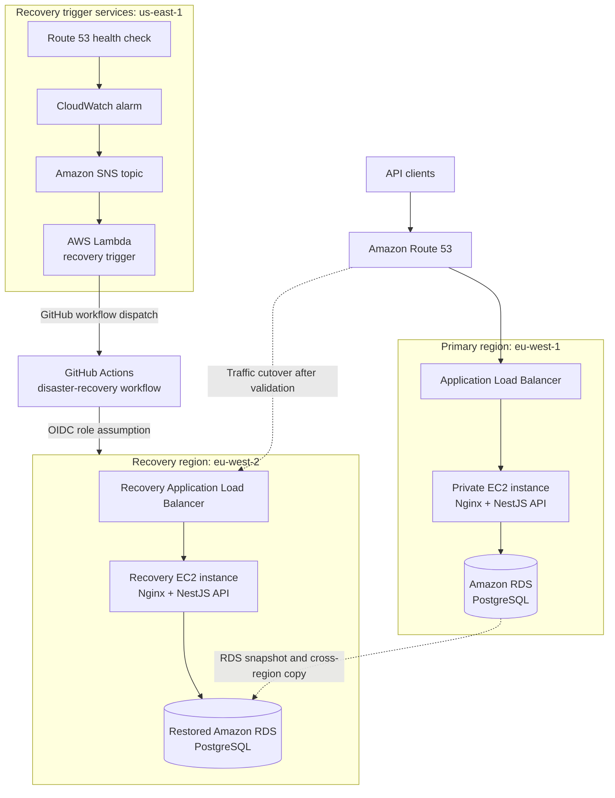
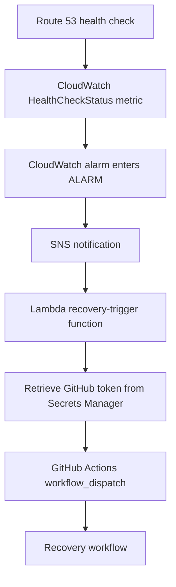

# CloudRecover

**A multi-region AWS disaster recovery platform that restores a NestJS inventory API and its PostgreSQL data in a secondary AWS region, with infrastructure provisioned through Terraform and recovery triggered through an event-driven GitHub Actions workflow.**

CloudRecover explores a practical disaster recovery question:

> If the primary application environment becomes unavailable, can the service and its database be restored in another AWS region, verified, and made available through the application’s normal DNS hostname?

The project combines backend engineering, infrastructure as code, AWS networking and IAM, CI/CD, monitoring-based failure detection, database snapshot recovery, and DNS-based traffic management.

<details>
<summary><strong>Project status</strong></summary>

The primary and recovery environments have been implemented and the recovery trigger path has been tested successfully. A Route 53 health-check test caused the CloudWatch/SNS/Lambda integration to dispatch the GitHub Actions recovery workflow, which completed successfully in under one minute in that test.

That duration is the observed workflow execution time for the test. It is **not** a measured end-to-end Recovery Time Objective (RTO): full recovery time also includes failure detection, database restoration, application readiness, DNS cutover, and client-side DNS caching. RPO and end-to-end RTO have not yet been formally measured.

</details>

---

## Contents

- [Project objectives](#project-objectives)
- [Architecture overview](#architecture-overview)
- [Disaster detection and recovery trigger](#disaster-detection-and-recovery-trigger)
- [Regional infrastructure](#regional-infrastructure)
- [Application and data](#application-and-data)
- [Technology stack](#technology-stack)
- [Terraform and state management](#terraform-and-state-management)
- [CI/CD and AWS authentication](#cicd-and-aws-authentication)
- [Recovery workflow](#recovery-workflow)
- [Health checks and validation](#health-checks-and-validation)
- [Testing and observed results](#testing-and-observed-results)
- [Repository structure](#repository-structure)
- [Deployment and operation](#deployment-and-operation)
- [Security considerations](#security-considerations)
- [Cost management and cleanup](#cost-management-and-cleanup)
- [Limitations and future improvements](#limitations-and-future-improvements)

---

## Project objectives

CloudRecover was built to demonstrate the engineering work involved in recovering a real application, not simply provisioning a second set of cloud resources.

The main objectives are to:

1. Build and deploy a NestJS inventory API backed by PostgreSQL.
2. Provision isolated primary and recovery environments in separate AWS regions.
3. Keep application instances and databases private, exposing the API through an Application Load Balancer.
4. Manage infrastructure using reusable Terraform modules and separate regional root configurations.
5. Deploy and operate infrastructure through GitHub Actions.
6. Authenticate GitHub Actions to AWS using OpenID Connect (OIDC), rather than long-lived AWS access keys.
7. Store and restore PostgreSQL data using cross-region RDS snapshots.
8. Detect primary endpoint health through Route 53 health checks and CloudWatch alarms.
9. Connect alarm notifications to a Lambda function that dispatches the recovery workflow.
10. Validate the recovered application before directing traffic to the recovery environment.

The application runs directly on Linux EC2 instances under `systemd`. Docker and Kubernetes are not part of this implementation.

---

## Architecture overview

### AWS regions and responsibilities

CloudRecover uses three AWS regions for distinct responsibilities.

| Region | Responsibility |
| --- | --- |
| `eu-west-1` | Primary application environment and primary PostgreSQL database |
| `eu-west-2` | Recovery environment, restored database, and recovery application infrastructure |
| `us-east-1` | Route 53 health-check alarm integration, SNS topic, and recovery-trigger Lambda |

The primary and recovery application environments are separate regional deployments. The monitoring-to-automation trigger components are deployed in `us-east-1`.

### High-level architecture



### Normal application request path

1. A client resolves the API hostname through Route 53.
2. Route 53 resolves the hostname to the primary Application Load Balancer.
3. The ALB terminates HTTPS.
4. The ALB forwards requests to the application instance in the private subnet.
5. Nginx forwards the request to the NestJS application.
6. NestJS accesses the primary PostgreSQL database through Prisma.
7. The response returns through Nginx and the ALB.

The EC2 application instance and RDS database are not intended to be directly exposed to the public internet.

---

## Disaster detection and recovery trigger

A central part of CloudRecover is the automated path from a primary endpoint health failure to a GitHub Actions recovery workflow.



### Trigger components

- **Route 53 health check:** Monitors the public primary ALB readiness endpoint, `/health/ready`.
- **CloudWatch:** Evaluates the Route 53 `HealthCheckStatus` metric and raises an alarm when the primary endpoint is considered unhealthy.
- **SNS:** Delivers the alarm notification to the subscribed Lambda function.
- **Lambda:** Filters for the expected alarm and `ALARM` state, retrieves the GitHub token from AWS Secrets Manager, and calls the GitHub API to dispatch the recovery workflow.
- **GitHub Actions:** Runs the recovery process and uses OIDC to obtain temporary AWS credentials.

The Lambda function is deployed in `us-east-1`. The recovery infrastructure it initiates is in `eu-west-2`.

**Important distinction:** SNS does not start GitHub Actions directly. SNS invokes Lambda; Lambda makes the authenticated GitHub API request that dispatches the workflow.

The Route 53 health check monitors a publicly reachable endpoint on the primary ALB. It does not attempt to access a private EC2 or database endpoint directly.

---

## Regional infrastructure

### Primary environment — `eu-west-1`

The primary environment hosts the normal production path for the project:

- Dedicated VPC and subnet architecture.
- Public Application Load Balancer.
- Private EC2 application instance.
- NestJS API managed by `systemd`.
- Nginx reverse proxy.
- Private Amazon RDS for PostgreSQL.
- Security groups controlling ALB-to-application and application-to-database traffic.

### Recovery environment — `eu-west-2`

The recovery environment contains the infrastructure and configuration required to reconstruct the service:

- Separate VPC and regional networking.
- Recovery Application Load Balancer.
- Recovery EC2 application instance.
- Restored Amazon RDS PostgreSQL database.
- Regional security groups and routing.
- Recovery application configuration and deployment process.

The recovery database is restored from a copied RDS snapshot. This is a backup-and-restore strategy: it provides a recoverable database point, not continuous synchronous replication of every write.

### Traffic management

Route 53 provides the application hostname and health-check-based failure detection. The recovery process validates the recovery environment before changing the DNS target.

DNS changes do not instantly replace cached answers everywhere. Client-side caching and existing connections can affect the time at which all clients use the recovery endpoint.

---

## Application and data

The application is a NestJS inventory API written in TypeScript and backed by PostgreSQL.

Prisma is used for database access and schema management.

The inventory domain includes products and stock movements. Stock adjustments are handled transactionally so the quantity change and its corresponding movement history remain consistent.

### Health endpoints

| Endpoint | Purpose |
| --- | --- |
| `/health/live` | Confirms that the application process is running; independent of database availability |
| `/health/ready` | Checks whether the application can reach its database and is ready to serve requests |

The distinction is important during an outage: an application process can still be alive while its database is unavailable. In that situation, liveness can remain successful while readiness returns `503`.

The Route 53 health check uses `/health/ready` through the public primary ALB.

---

## Technology stack

| Area | Technology | Responsibility |
| --- | --- | --- |
| Language | TypeScript | Application implementation |
| Backend | NestJS / Node.js | REST API and application services |
| ORM | Prisma | PostgreSQL access and schema management |
| Database | Amazon RDS for PostgreSQL | Persistent inventory data |
| Compute | Amazon EC2 | Primary and recovery application hosts |
| Networking | Amazon VPC | Regional network isolation |
| Load balancing | Application Load Balancer | Public HTTPS entry point and target routing |
| DNS and health checks | Amazon Route 53 | API DNS and primary endpoint health monitoring |
| Infrastructure as Code | Terraform | Regional infrastructure provisioning |
| CI/CD | GitHub Actions | Infrastructure and recovery automation |
| AWS authentication | GitHub OIDC and IAM | Temporary AWS credentials for workflows |
| Remote administration | AWS Systems Manager | Private instance management and commands |
| Database recovery | Amazon RDS snapshots | Cross-region backup and restoration |
| Event notifications | Amazon SNS | Delivery of CloudWatch alarm notifications |
| Event processing | AWS Lambda | GitHub Actions workflow dispatch |
| Secrets | AWS Secrets Manager | Secure storage and retrieval of the GitHub token |
| Monitoring | Amazon CloudWatch | Route 53 health-check metric and alarm |
| Application process management | systemd | Service startup and restart management |
| Reverse proxy | Nginx | Request forwarding to NestJS |

---

## Terraform and state management

Infrastructure is organized into separate regional Terraform roots, with reusable modules for shared infrastructure concerns.

```text
infrastructure/
├── modules/
│   ├── networking/
│   ├── security/
│   ├── application/
│   ├── database/
│   ├── load-balancer/
│   └── ...
├── primary/
└── secondary/
```

The primary and secondary roots are applied independently. This keeps the regional infrastructure configurations and Terraform states separate.

The secondary configuration also manages the recovery-trigger Lambda resources through an aliased provider for `us-east-1`. This allows the recovery root to manage the Lambda integration while the recovery application infrastructure remains in `eu-west-2`.

### Remote state

The secondary Terraform state is stored in Amazon S3:

- Bucket: `tinoscriptdevops`
- Key: `cloudrecover/secondary/terraform.tfstate`
- State locking: S3 lock file (`.tflock`)

The primary and secondary configurations use separate state locations. Keep state access restricted because Terraform state can contain sensitive infrastructure metadata and resource attributes.

### Typical Terraform workflow

Run Terraform from the relevant regional root directory and review the plan before applying changes.

```bash
terraform init
terraform validate
terraform plan
terraform apply
```

Use the appropriate root directory and AWS region for the infrastructure being changed. Do not apply or destroy both regional environments as though they were a single state.

---

## CI/CD and AWS authentication

GitHub Actions is used to automate infrastructure and recovery operations.

### OIDC authentication

The GitHub Actions workflow assumes the IAM role:

`CloudRecover-GitHubActions-DR-Role`

The workflow obtains temporary AWS credentials through the AWS Security Token Service (STS) `AssumeRoleWithWebIdentity` flow.

This avoids storing long-lived AWS access keys as GitHub repository secrets.

The IAM trust relationship restricts which GitHub repository and workflow identity can assume the role. The role's permissions are defined separately in its identity-based IAM policies.

### Two separate authentication paths

CloudRecover deliberately uses different credentials for two different responsibilities:

1. **Lambda to GitHub:** Lambda uses its AWS execution role to access the required AWS resources, retrieves a GitHub personal access token from Secrets Manager, and uses that token to call the GitHub workflow-dispatch API.
2. **GitHub Actions to AWS:** The workflow uses GitHub OIDC to assume the `CloudRecover-GitHubActions-DR-Role` and receive temporary AWS credentials.

These are separate trust and authorization paths. The Lambda execution role is not the GitHub Actions OIDC role.

### Recovery workflow

The recovery workflow supports manual dispatch as well as dispatch initiated by the Lambda integration. It accepts recovery inputs such as the action to perform and an optional snapshot identifier. When no snapshot identifier is supplied, the workflow can select the latest available eligible primary snapshot according to its implemented selection logic.

---

## Recovery workflow

The recovery workflow automates the infrastructure and application recovery steps in the secondary region.

At a high level, it:

1. Receives a manual or automated workflow dispatch.
2. Determines the requested recovery action and snapshot selection.
3. Authenticates to AWS through GitHub OIDC.
4. Uses the secondary Terraform configuration to provision or update recovery resources.
5. Restores the recovery PostgreSQL database from the selected snapshot when required.
6. Deploys or starts the application on the recovery EC2 instance.
7. Uses Systems Manager for private instance operations.
8. Validates the recovery application through its health endpoints and load balancer path.
9. Performs the configured DNS recovery operation after the required recovery steps.

The workflow can also be run in a planning mode before applying changes. Review the workflow inputs and Terraform plan before executing destructive or state-changing operations.

### Recovery is not the same as failback

This project demonstrates recovery into the secondary region. Returning service to the original primary region after new writes have occurred in recovery requires a deliberate data synchronization and cutback procedure. Simply changing DNS back would risk losing writes made against the recovered database.

A fully automated failback process is not claimed as part of the current implementation.

---

## Health checks and validation

CloudRecover separates process health from dependency readiness.

- `/health/live` indicates whether the NestJS process is responding.
- `/health/ready` verifies database connectivity and indicates whether the service can serve requests that depend on PostgreSQL.

The primary Route 53 health check monitors the readiness endpoint through the public ALB. This tests the externally reachable application path rather than relying only on an internal process check.

During validation, the recovery environment should be checked through the ALB and application health endpoints before DNS traffic is directed to it.

---

## Testing and observed results

The project has been tested beyond Terraform provisioning.

| Test | Observed result |
| --- | --- |
| Primary application and database deployment | Implemented |
| Recovery application and database environment | Implemented |
| Primary readiness endpoint | Tested |
| Database connectivity failure simulation | Tested by removing the primary RDS ingress rule from the application security group |
| Liveness while database is unavailable | Remained healthy, as expected |
| Readiness while database is unavailable | Returned `503`, as expected |
| Recovery ALB readiness path | Verified with successful HTTP responses during final validation |
| Route 53 health-check trigger | Tested |
| CloudWatch → SNS → Lambda notification path | Triggered through the health-check alarm integration |
| Lambda → GitHub Actions dispatch | Tested successfully |
| Recovery workflow execution | Completed successfully; the tested workflow run finished in under one minute |

The database failure simulation did not delete the database or its data. It temporarily removed the permitted network path from the application security group to PostgreSQL, allowing the application health endpoints to be tested under a dependency failure.

### Recovery metrics: what is and is not measured

| Metric | Current status |
| --- | --- |
| Recovery workflow execution time in the observed trigger test | Under one minute |
| End-to-end RTO | Not formally measured |
| RPO / data-loss window | Not formally measured |
| Snapshot age at recovery | Not recorded here |
| Time for snapshot restore and database readiness | Not separately recorded |
| DNS propagation and client convergence | Not formally measured |

Do not interpret the under-one-minute workflow run as the complete disaster recovery time. The end-to-end RTO must be measured from a clearly defined outage start or detection point until clients can successfully use the recovered service through the normal hostname.

Likewise, RPO must be established by comparing known writes with the data present after restoration, not by assuming that snapshot creation or workflow execution time represents data loss.

---

## Repository structure

The repository contains the application, regional Terraform configurations, recovery-trigger implementation, and GitHub Actions workflows. The exact module and script layout may evolve as the project is maintained.

```text
cloudrecover/
├── cloudrecover-api/
│   ├── src/
│   ├── prisma/
│   └── ...
├── infrastructure/
│   ├── modules/
│   ├── primary/
│   └── secondary/
├── lambda/
│   └── recovery-trigger/
├── .github/
│   └── workflows/
└── README.md
```

---

## Deployment and operation

### Prerequisites

- AWS account with permissions to manage the required infrastructure.
- Terraform.
- AWS CLI.
- Git and GitHub repository access.
- Node.js and npm for local API development.
- GitHub Actions configured for OIDC authentication.
- Required AWS secrets, IAM roles, and regional configuration.

### Local API development

From the API directory:

```bash
npm install
```

Configure the local PostgreSQL connection using the project's environment template, then run the applicable Prisma migration and NestJS development commands defined in the package scripts.

Do not commit `.env` files or real credentials.

### Infrastructure changes

Use the primary or secondary Terraform root as appropriate:

```bash
cd infrastructure/primary
terraform init
terraform validate
terraform plan
```

For recovery-region changes, use `infrastructure/secondary` instead.

Always inspect the plan and verify the selected AWS account and region before applying.

### Recovery execution

Recovery can be initiated through the configured GitHub Actions workflow dispatch. The event-driven path can also initiate the workflow when the Route 53 health-check alarm transitions to the expected alarm state.

Use the workflow's documented inputs and review its logs and outputs to confirm which recovery point and infrastructure actions were selected.

---

## Security considerations

- Keep application instances and RDS databases in private subnets.
- Permit database access only from the intended application security group.
- Expose the API through the Application Load Balancer rather than directly exposing the EC2 application host.
- Use GitHub OIDC for workflow-to-AWS authentication instead of long-lived AWS access keys.
- Keep the Lambda-to-GitHub token in Secrets Manager and grant the Lambda execution role only the required access.
- Keep the Lambda execution role and GitHub Actions IAM role separate.
- Scope IAM permissions to the resources and actions required by each workflow.
- Do not commit credentials, Terraform state, private keys, or real environment files.
- Treat Terraform state and recovery metadata as sensitive operational data.
- Verify the selected snapshot and recovery region before running recovery operations.

---

## Cost management and cleanup

CloudRecover provisions resources that can incur ongoing AWS charges, including EC2 instances, RDS databases, Application Load Balancers, NAT gateways, EBS volumes, snapshot storage, S3 objects, and data transfer.

The recovery environment is intended to be created or operated when required by the recovery workflow rather than kept fully running without a reason.

Before destroying resources:

1. Identify which Terraform root and AWS region are targeted.
2. Review the complete Terraform destroy plan.
3. Preserve snapshots, release artifacts, state files, and evidence that must be retained.
4. Check for resources that may not be removed automatically, including snapshots, S3 objects, and retained storage.
5. Confirm that shared IAM, OIDC, and recovery-trigger resources are not being destroyed unintentionally.

Stopping an EC2 instance does not stop charges for every associated resource. Review the AWS billing console after cleanup.

---

## Limitations and future improvements

CloudRecover demonstrates a working regional recovery path, but it is not presented as a fully automated, zero-downtime, continuously replicated disaster recovery platform.

Potential improvements include:

- Measure end-to-end RTO across detection, database restoration, application readiness, and DNS convergence.
- Measure RPO by comparing known application writes with the restored database.
- Automate recurring recovery drills and retain timestamped test evidence.
- Add explicit recovery-point freshness checks and backup retention policies.
- Implement and test a controlled failback process.
- Add write fencing to prevent conflicting writes if both regions become active.
- Improve recovery observability with structured logs and detailed workflow timing.
- Evaluate pilot-light or warm-standby designs against the current backup-and-restore approach.
- Add stronger application authentication, authorization, and audit controls where the API is exposed beyond a controlled demonstration environment.

---

## What this project demonstrates

CloudRecover brings together several engineering concerns that are often treated separately:

- Designing and deploying a backend service with persistent data.
- Building isolated multi-region AWS infrastructure with Terraform.
- Managing infrastructure state across independent regional roots.
- Applying least-privilege IAM and workload identity through GitHub OIDC.
- Automating private server operations with Systems Manager.
- Restoring PostgreSQL data from cross-region snapshots.
- Connecting infrastructure health signals to an automated recovery workflow.
- Validating service readiness before DNS traffic cutover.
- Distinguishing workflow duration from real recovery objectives.

The main outcome is an implemented and tested recovery trigger and regional recovery workflow—not just a diagram of a possible disaster recovery architecture.
